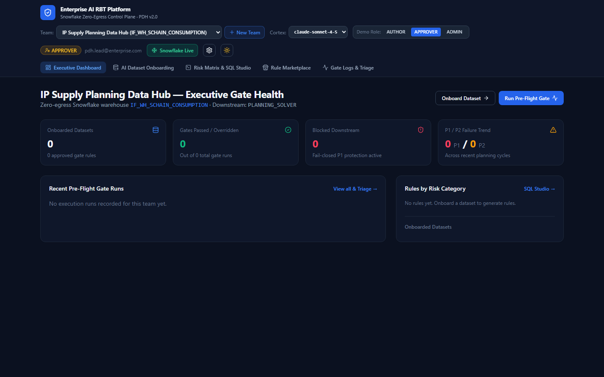
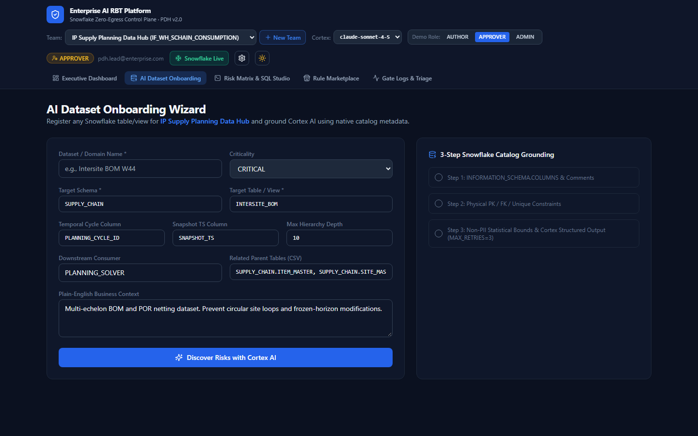
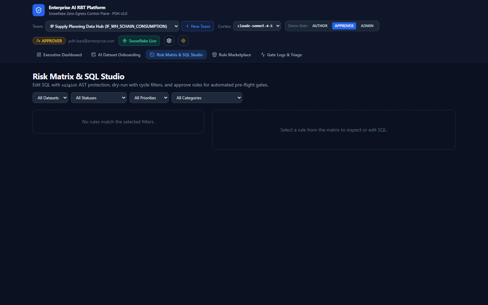
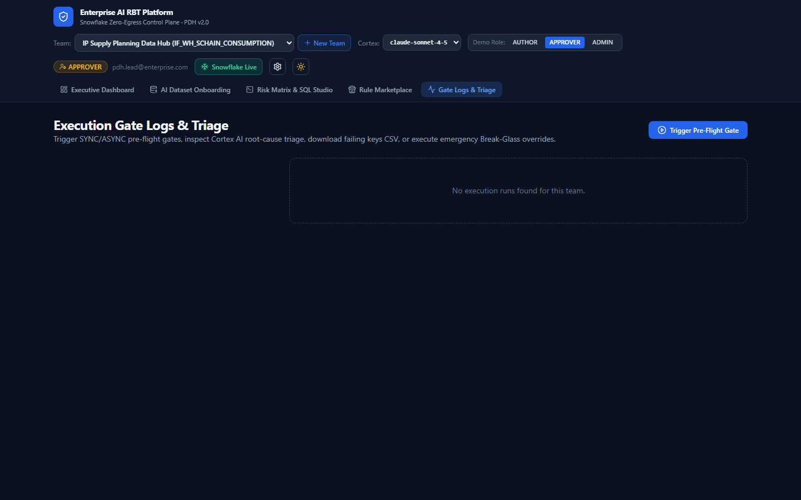
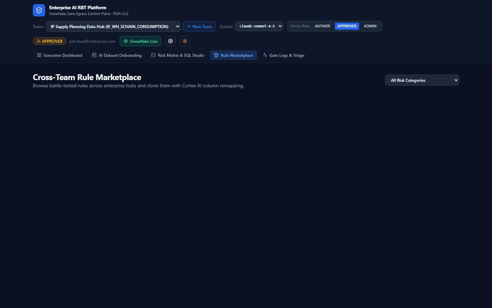

# 🛡️ Enterprise AI Risk-Based Testing (RBT) Platform (PDH v2.0)

> **Simple, zero-data-egress data quality testing powered by Snowflake & Cortex AI.**  
> Inspect any Snowflake table, let AI write SQL quality checks for you, test rules in a built-in SQL studio, and block bad data before it reaches downstream supply-chain planners.

[](./architecture.md)
[](http://localhost:3000)
[](http://localhost:8000/docs)
[](http://localhost:3000/help)

---

## 🧭 Quick Navigation

| Section | What You'll Find | Link |
| :--- | :--- | :--- |
| 💡 **What This App Does** | Plain-English overview of the platform | [Jump](#-what-this-app-does) |
| 🖥️ **Step-by-Step Tour (With Screenshots)** | Visual guide for every screen | [Jump](#-step-by-step-visual-tour) |
| 🚀 **How to Run Locally** | Start Backend + Frontend in 2 commands | [Jump](#-how-to-run-locally) |
| 🧪 **How to Test Everything** | Automated tests + live browser checks | [Jump](#-how-to-test-everything) |
| 🔌 **Pipeline Automation (`X-API-Key`)** | Trigger quality gates from Airflow / Control-M | [Jump](#-pipeline-automation-x-api-key) |
| 🏗️ **Deep-Dive Architecture** | Diagrams, tech stack, data flow & ER model | [architecture.md](./architecture.md) |

---

## 💡 What This App Does

Think of this platform as an **automated quality gatekeeper** for your Snowflake data:

1. **🔒 Your Data Never Leaves Snowflake** — All table profiling, AI rule generation (`SNOWFLAKE.CORTEX.COMPLETE`), and SQL checks run directly inside Snowflake.
2. **🤖 AI Writes Your Test Rules** — Pick a table, and Cortex AI (`claude-sonnet-4-5`, `llama3.3-70b`, `llama3.1-70b`, or `mistral-large2`) inspects the columns and writes SQL rules automatically.
3. **🏢 Multi-Team Ready (6 Data Hubs)** — Supports **IP & IF Supply, Demand, and Material Planning Data Hubs**, each isolated with its own warehouse, rules, and API keys.
4. **🚦 Safe by Design** — Every SQL rule is checked by an AST guardrail (`sqlglot`) to ensure only read-only `SELECT` queries run.

---

## 🖥️ Step-by-Step Visual Tour

> Need this inside the app? Click **Help & Guide** in the top navigation bar or open [http://localhost:3000/help](http://localhost:3000/help).

### Step 1 — Sign In with Snowflake SSO & Pick Your Team
Click **`Snowflake SSO`** in the top bar to sign in via Intel SSO in one click, choose your **Data Hub** from the **Team** dropdown, and select your preferred **Cortex AI Model**.



---

### Step 2 — Onboard a Table & Generate AI Rules ([`/onboard`](http://localhost:3000/onboard))
Select a **Target Schema** from your team's Snowflake database dropdown, enter a **Target Table / View**, and click **Onboard & Generate Rules**. Cortex AI reads `INFORMATION_SCHEMA` metadata and creates SQL rules for you.



---

### Step 3 — Review, Edit & Dry-Run Rules ([`/rules`](http://localhost:3000/rules))
Browse all rules in **Risk Matrix & SQL Studio**, edit SQL in the built-in editor (every save creates a new version), and click **Dry Run** to test any rule live against Snowflake.



---

### Step 4 — Run Quality Gates & Read AI Diagnosis ([`/runs`](http://localhost:3000/runs))
Run all approved rules together as a batch gate. If any rows fail, inspect sample failing keys, download CSVs, and read the **AI Triage Summary** to understand the root cause.



---

### Step 5 — Share & Reuse Rules Across Teams ([`/marketplace`](http://localhost:3000/marketplace))
Browse proven rules created by other Data Hubs and click **Clone** to copy a rule into your own Data Hub (AI automatically remaps column names to your target table).



---

## 🚀 How to Run Locally

<details open>
<summary><strong>▶️ Option A: Run Local Dev Servers (Recommended for Live Snowflake SSO)</strong></summary>

1. **Start the Backend (FastAPI on port `8000`)**
   ```powershell
   cd backend
   .venv\Scripts\python.exe -m uvicorn app.main:app --host 0.0.0.0 --port 8000
   ```
2. **Start the Frontend (Next.js on port `3000`)**
   ```powershell
   cd frontend
   npm run start -- -p 3000
   ```
3. Open **[http://localhost:3000](http://localhost:3000)** and click **`Snowflake SSO`** in the top bar.

</details>

<details>
<summary><strong>🐳 Option B: Run with Docker Compose (Local Mock Mode)</strong></summary>

```bash
cp .env.example .env
docker compose up --build
```
- **Web UI:** [http://localhost:3000](http://localhost:3000)
- **FastAPI Swagger Docs:** [http://localhost:8000/docs](http://localhost:8000/docs)

</details>

<details>
<summary><strong>⚙️ Live Snowflake Configuration (<code>backend/.env</code>)</strong></summary>

Set `SNOWFLAKE_MOCK_MODE=false` in `backend/.env` with your Snowflake connection details:
- **Account:** `XD14286-IFCDWm4`
- **Database / Schema:** `IF_SUPPLY_CHAIN.PDH_SUPPLY_PLANNING_SRC_BASE`
- **Warehouse:** `IF_WH_SCHAIN_CONSUMPTION`
- **Auth:** `SNOWFLAKE_AUTHENTICATOR=externalbrowser` (one-click **Snowflake SSO** button in UI) or `SNOWFLAKE_PRIVATE_KEY_PATH` (PKCS#8)
- **Default AI Model:** `CORTEX_MODEL=claude-sonnet-4-5`

Initial DDL lives in [backend/app/db/migrations/01_init_ddl.sql](./backend/app/db/migrations/01_init_ddl.sql).

</details>

---

## 🧪 How to Test Everything

| Check | Command | What It Verifies |
| :--- | :--- | :--- |
| **Backend Tests** | `backend\.venv\Scripts\python.exe -m pytest backend\tests -q` | RBAC isolation, SQL AST guardrails, onboarding, Cortex parsing, versioning, gate execution, marketplace (`28 passed`) |
| **TypeScript Check** | `cd frontend; npx tsc --noEmit` | Zero type errors across all pages & components |
| **Production Build** | `cd frontend; npm run build` | Clean Next.js 14 build for all routes (`/`, `/onboard`, `/rules`, `/marketplace`, `/runs`, `/help`) |
| **Interactive API Docs** | Open [http://localhost:8000/docs](http://localhost:8000/docs) | Test any REST endpoint directly via Swagger UI |

---

## 🔌 Pipeline Automation (`X-API-Key`)

External orchestrators (Airflow, Control-M, dbt, CI/CD) can trigger quality gates without browser SSO by passing a team's **`X-API-Key`** (generated/rotated in the **Settings** gear icon in the UI).

<details>
<summary><strong>📡 Click to view <code>curl</code> examples for Synchronous & Asynchronous Gates</strong></summary>

#### 1. Synchronous Gate (`HTTP 200` Pass / `HTTP 422` Blocked)
```bash
curl -i -X POST http://localhost:8000/api/v1/execution/run-gate \
  -H "Content-Type: application/json" \
  -H "X-API-Key: <YOUR_TEAM_API_KEY>" \
  -d '{
    "team_id": "team_if_supply",
    "domain_id": "<DOMAIN_ID>",
    "triggered_by": "ORCHESTRATOR_API",
    "execution_mode": "SYNC",
    "planning_cycle_id": "2026_W46_POR"
  }'
```

#### 2. Asynchronous Gate (`HTTP 202 Accepted` + Polling)
```bash
curl -s -X POST http://localhost:8000/api/v1/execution/run-gate \
  -H "Content-Type: application/json" \
  -H "X-API-Key: <YOUR_TEAM_API_KEY>" \
  -d '{
    "team_id": "team_if_supply",
    "domain_id": "<DOMAIN_ID>",
    "triggered_by": "CI_CD",
    "execution_mode": "ASYNC",
    "planning_cycle_id": "2026_W46_POR"
  }'

# Poll run status
curl -s http://localhost:8000/api/v1/runs/<RUN_ID> \
  -H "X-API-Key: <YOUR_TEAM_API_KEY>"
```

</details>

---

## 📚 Related Documentation
- 🏗️ **[architecture.md](./architecture.md)** — High-level architecture, technology stack, integrations, working model, data flow, and database ER diagram.
- 📖 **[frontend/src/app/help/page.tsx](./frontend/src/app/help/page.tsx)** — Built-in Help & Guide page (`/help`).
- ⚙️ **[backend/app/config.py](./backend/app/config.py)** — Environment & Snowflake Cortex configuration.
