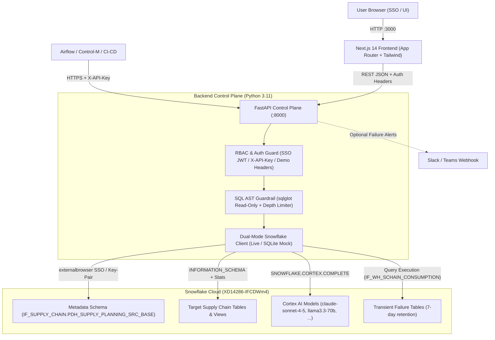
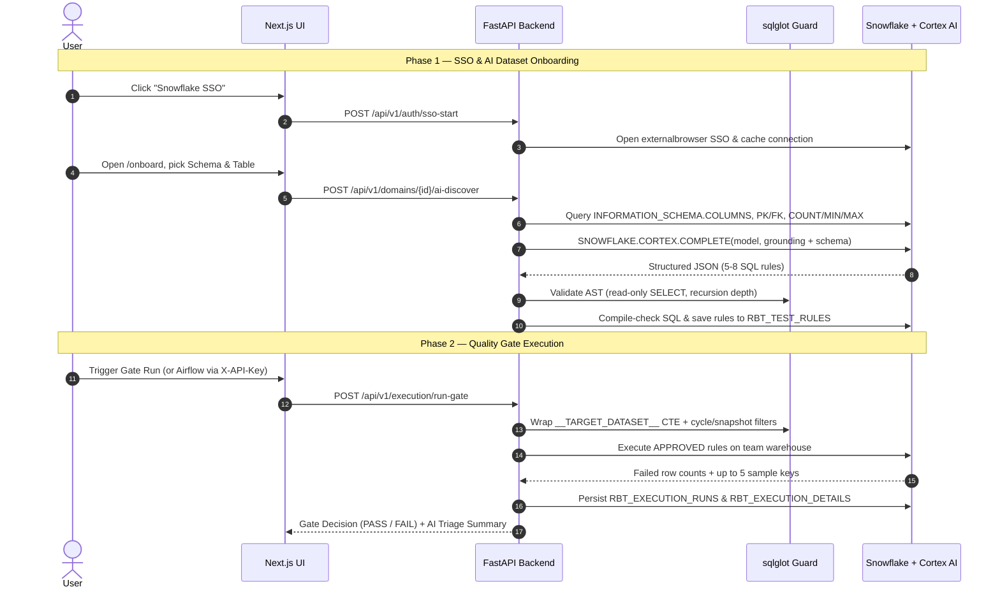
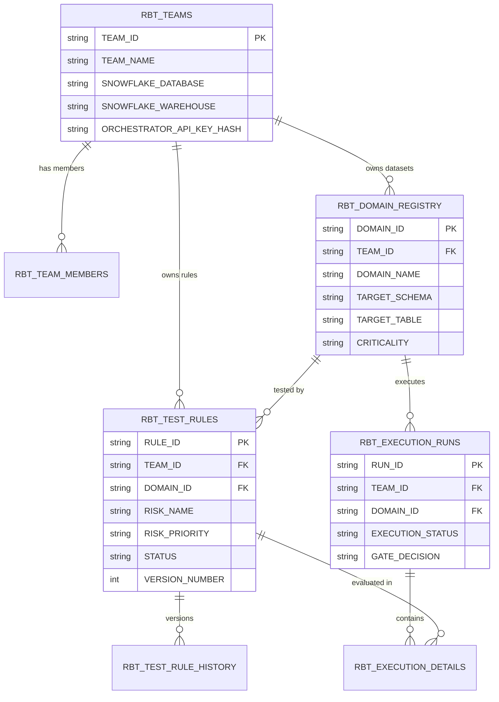

# 🏗️ System Architecture — Enterprise AI RBT Platform

> **Zero-Data-Egress Control Plane** for AI-assisted Risk-Based Testing on **Snowflake** + **Snowflake Cortex AI**.  
> Back to [README.md](./README.md) · Live UI: [http://localhost:3000](http://localhost:3000) · API Docs: [http://localhost:8000/docs](http://localhost:8000/docs)

---

## 🧭 Table of Contents
1. [High-Level Architecture](#-1-high-level-architecture)
2. [Technology Stack](#-2-technology-stack)
3. [External & Internal Integrations](#-3-external--internal-integrations)
4. [Working Model & Governance](#-4-working-model--governance)
5. [End-to-End Data Flow](#-5-end-to-end-data-flow)
6. [Metadata Data Model (ER Diagram)](#-6-metadata-data-model-er-diagram)

---

## 🌐 1. High-Level Architecture

The platform separates **UI/Control Plane** (Next.js + FastAPI) from **Data & AI Compute** (Snowflake Warehouse + Cortex). Raw business data never leaves Snowflake; only metadata, SQL definitions, aggregate counts, and up to 5 sample failing keys are returned to the control plane.



---

## 🧰 2. Technology Stack

| Layer | Technology | Purpose | Key Files |
| :--- | :--- | :--- | :--- |
| **Frontend UI** | **Next.js 14** (App Router), **React 18**, **TypeScript** | Multi-page SPA with client state & routing | [frontend/src/app/layout.tsx](./frontend/src/app/layout.tsx), [AppContext.tsx](./frontend/src/components/AppContext.tsx) |
| **Styling & Icons** | **Tailwind CSS**, **Lucide React** | Full-width responsive layout, Light/Dark mode | [AppShell.tsx](./frontend/src/components/AppShell.tsx) |
| **SQL Studio** | **CodeMirror 6** (`@uiw/react-codemirror`, `@codemirror/lang-sql`) | Interactive SQL rule editing & syntax highlighting | [SqlEditor.tsx](./frontend/src/components/SqlEditor.tsx) |
| **Backend API** | **FastAPI**, **Pydantic v2**, **Uvicorn** | REST APIs, OpenAPI Swagger docs, async gate execution | [backend/app/main.py](./backend/app/main.py), [models.py](./backend/app/schemas/models.py) |
| **SQL Security** | **sqlglot** AST Parser | Blocks DML/DDL, enforces single-statement `SELECT`, bounds recursion | [sql_validator.py](./backend/app/security/sql_validator.py) |
| **Snowflake Connector** | **snowflake-connector-python** | Live SSO (`externalbrowser`), key-pair auth, Cortex & query execution | [snowflake_client.py](./backend/app/db/snowflake_client.py) |
| **Local Mock Engine** | **SQLite** (in-memory/local) | Zero-dependency local testing when `SNOWFLAKE_MOCK_MODE=true` | [snowflake_client.py](./backend/app/db/snowflake_client.py) |
| **Testing** | **pytest**, **httpx**, **TypeScript (`tsc`)** | 28 automated API/RBAC/AST tests + strict typechecking | [backend/tests](./backend/tests) |

---

## 🔗 3. External & Internal Integrations

<details open>
<summary><strong>❄️ Snowflake SSO & Compute Integration</strong></summary>

- **Authentication:** `externalbrowser` SSO triggered from the **`Snowflake SSO`** button in the UI (`GET /api/v1/auth/sso-status`, `POST /api/v1/auth/sso-start`) or PKCS#8 private-key auth for headless deployments.
- **Session Reuse:** The backend holds a thread-safe (`RLock`) SSO connection proxy (`_NoCloseConnProxy`) so users authenticate once per server session.
- **Metadata & Execution Isolation:** Team metadata resides in `IF_SUPPLY_CHAIN.PDH_SUPPLY_PLANNING_SRC_BASE`, while queries run on each team's configured warehouse (e.g., `IF_WH_SCHAIN_CONSUMPTION`).

</details>

<details open>
<summary><strong>🧠 Snowflake Cortex AI Integration</strong></summary>

- **Dynamic Model Selection:** `GET /api/v1/cortex/models` exposes verified models on the account (`claude-sonnet-4-5`, `llama3.3-70b`, `llama3.1-70b`, `mistral-large2`).
- **Structured Outputs:** `SNOWFLAKE.CORTEX.COMPLETE(model, messages, response_format)` generates schema-validated JSON rules (`CORTEX_RULE_LIST_SCHEMA`), auto-debug SQL fixes, marketplace column remapping (`CORTEX_REMAP_SCHEMA`), and plain-English failure triage summaries.

</details>

<details open>
<summary><strong>⚙️ Orchestrator & Webhook Integrations</strong></summary>

- **Airflow / Control-M / CI-CD:** Call `POST /api/v1/execution/run-gate` (`SYNC` or `ASYNC`) and `GET /api/v1/runs/{run_id}` using the team's `X-API-Key` header (stored as a SHA-256 hash in `RBT_TEAMS`).
- **Alert Webhooks:** Teams can configure an `alert_webhook_url` in Team Settings to receive failure notifications when a quality gate blocks downstream execution.

</details>

---

## 🛡️ 4. Working Model & Governance

### Role-Based Access Control (RBAC)
Enforced by [dependencies.py](./backend/app/auth/dependencies.py):

| Role | Level | Permissions |
| :--- | :---: | :--- |
| **`AUTHOR`** | 1 | View teams/schemas/rules, onboard datasets, run AI discovery, edit & dry-run SQL rules |
| **`APPROVER`** | 2 | Everything in `AUTHOR` + approve/archive rules, execute **Break-Glass Override** on failed gates |
| **`ADMIN`** | 3 | Everything in `APPROVER` + create/update teams, manage team members, rotate `X-API-Key` |

### Rule Lifecycle
```
AI Generated / Manual Draft ──▶ [ DRAFT ] ──(APPROVER)──▶ [ APPROVED ] ──▶ [ ARCHIVED ]
                                    │                           ▲
                              (Edit SQL)                        │
                                    └──▶ New Version Saved ─────┘
```
- **Versioning:** Every edit to a rule's SQL inserts an immutable snapshot into `RBT_TEST_RULE_HISTORY` and increments `VERSION_NUMBER`.
- **Execution Semantics:** Every rule SQL query is written so **`0 rows returned = PASS`** and **`>= 1 row returned = FAIL`**.
- **Gate Decision:**
  - Any `APPROVED` **P1 (Critical)** failure → `FAIL` (`allow_downstream = false`, `HTTP 422` in `SYNC` mode).
  - Only **P2/P3** failures → `PASS_WITH_WARNINGS` (`allow_downstream = true`).
  - Manual `APPROVER` override → `OVERRIDDEN_PASS`.

---

## 🔄 5. End-to-End Data Flow



---

## 🗄️ 6. Metadata Data Model (ER Diagram)

All 7 metadata tables are defined in [01_init_ddl.sql](./backend/app/db/migrations/01_init_ddl.sql) and hosted in `IF_SUPPLY_CHAIN.PDH_SUPPLY_PLANNING_SRC_BASE`:


